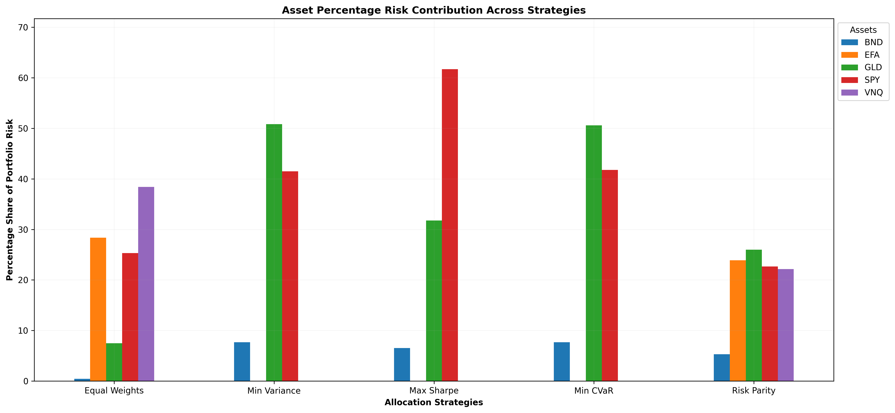
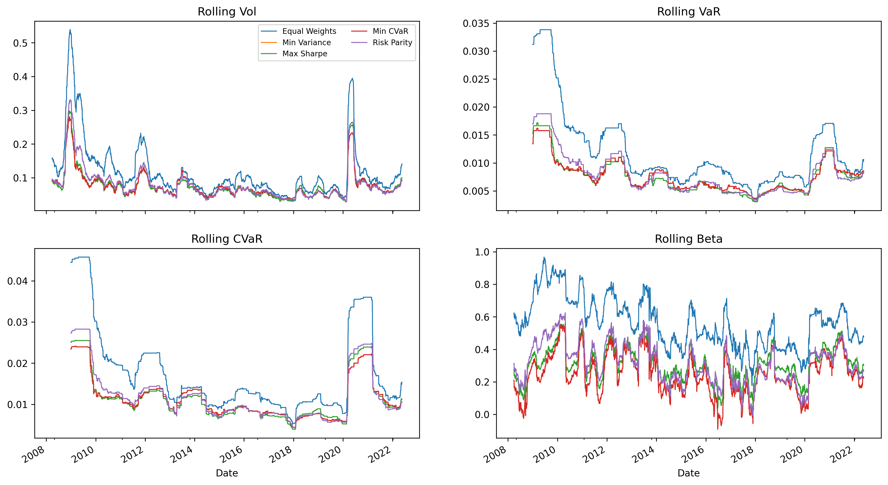
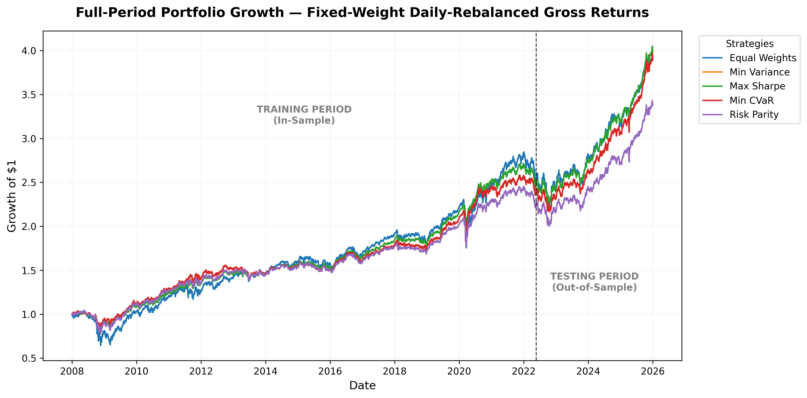

# Portfolio Optimization & Risk Management System

A Python-based quantitative portfolio research project that develops and evaluates five portfolio allocation strategies across a diversified ETF universe. The system combines portfolio optimization, risk decomposition, transaction-cost modelling, dynamic risk monitoring, historical stress testing, out-of-sample validation, and risk-limit monitoring.

## Project Overview

The objective is to examine how different portfolio construction methods allocate capital, distribute risk, and perform under different market conditions.

Rather than evaluating portfolios solely on returns, the system considers risk-adjusted performance, downside risk, portfolio concentration, rebalancing costs, and out-of-sample behaviour.

The analysis is implemented in Python using NumPy, Pandas, SciPy, Matplotlib, and Yahoo Finance data through `yfinance`.

---

## 🖼️ Visuals & Results Dashboards

> *The underlying numerical data supporting these visuals — including portfolio weights, performance tables, risk decompositions, transaction costs, stress testing matrices, and dashboard summaries — are fully available as CSVs in `results/tables/`.*

### 1. Asset Risk Contribution
Deconstructs total portfolio volatility into marginal and percentage risk contributions per asset, illustrating how risk concentration differs across strategies (such as validating Risk Parity convergence).
[](https://github.com/KayCee174/portfolio_optimization_risk_system/blob/main/results/figures/01_asset_risk_contribution.png)

### 2. Rolling Risk Monitoring
Tracks temporal risk evolution using rolling window metrics (such as 60-day rolling volatility and beta relative to SPY, alongside rolling VaR and CVaR) to highlight structural regime shifts over time.
[](https://github.com/KayCee174/portfolio_optimization_risk_system/blob/main/results/figures/02_rolling_risk_monitoring.png)

### 3. Portfolio Growth Comparison
Visualizes cumulative out-of-sample growth trajectories across all optimized allocation strategies versus the baseline equal-weight benchmark.
[](https://github.com/KayCee174/portfolio_optimization_risk_system/blob/main/results/figures/03_portfolio_growth_comparison.png)

---

## Asset Universe

The analysis uses five exchange-traded funds (ETFs), representing different asset classes and market exposures.

| Ticker | Asset | Portfolio Exposure |
|---|---|---|
| BND | Vanguard Total Bond Market ETF | US investment-grade bonds |
| EFA | iShares MSCI EAFE ETF | Developed-market equities outside the US and Canada |
| GLD | SPDR Gold Shares | Gold |
| SPY | SPDR S&P 500 ETF Trust | US large-cap equities |
| VNQ | Vanguard Real Estate ETF | US listed real estate / REITs |

Adjusted daily closing prices are retrieved from Yahoo Finance. Daily simple returns are calculated using percentage changes.

**Data period:** 31 December 2007 – 31 December 2025  
**Observations:** 4,530 trading days

## Portfolio Construction

Five allocation strategies are implemented and compared:

1. **Equal Weights** — allocates capital equally across all five assets.
2. **Minimum Variance** — minimizes portfolio variance using the estimated covariance matrix.
3. **Maximum Sharpe Ratio** — maximizes expected excess return relative to portfolio volatility.
4. **Minimum CVaR** — minimizes historical Conditional Value at Risk at the 95% confidence level.
5. **Risk Parity** — seeks to equalize the assets' contributions to total portfolio volatility.

The four optimized strategies use SciPy's Sequential Least Squares Programming (SLSQP) optimizer.

### Optimization constraints

- Fully invested portfolio: weights sum to 100%.
- Long-only allocation: no short positions.
- Maximum asset allocation: 40%.
- Annualization factor: 252 trading days.
- Assumed annual risk-free rate: 0%.

## Research Framework

The notebook is organized into nine modules.

| Module | Research Component |
|---|---|
| 1 | Data Acquisition, Preprocessing & Portfolio Construction |
| 2 | In-Sample Portfolio Risk & Performance |
| 3 | Portfolio Risk Composition |
| 4 | Portfolio Implementation & Trading Frictions |
| 5 | Dynamic Risk Monitoring |
| 6 | Historical Stress Testing |
| 7 | Out-of-Sample Portfolio Validation |
| 8 | Benchmarking, Attribution & Strategy Comparison |
| 9 | Portfolio Risk Limits & Final Dashboard |

### Risk and performance metrics

The system evaluates portfolios using:

- Annualized mean return and volatility
- Sharpe ratio
- Historical Value at Risk (VaR)
- Conditional Value at Risk (CVaR)
- Maximum drawdown
- Asset-level risk contribution
- Rolling volatility, VaR, CVaR, and beta
- Portfolio turnover and asset-weight drift
- Active return, tracking error, and information ratio

## Backtesting and Validation

A chronological 80/20 split is used to separate portfolio estimation from performance evaluation.

| Dataset | Period | Trading Days |
|---|---|---:|
| Training / In-Sample | 2 Jan 2008 – 20 May 2022 | 3,623 |
| Testing / Out-of-Sample | 23 May 2022 – 31 Dec 2025 | 906 |

Portfolio weights are estimated using the training dataset and held fixed throughout the out-of-sample evaluation.

The out-of-sample period is used to examine whether the optimized allocations retain their risk and return characteristics on data not used for portfolio estimation.

### VaR model validation

The 95% historical VaR forecasts are estimated from the training period and evaluated against out-of-sample returns using the Kupiec Proportion of Failures (POF) test.

The test evaluates whether the observed frequency of VaR exceptions is statistically consistent with the expected failure probability.

A failure to reject the null hypothesis does not establish that a VaR model is fully accurate. The POF test evaluates unconditional coverage and does not assess the independence or clustering of exceptions.

## Transaction Costs and Rebalancing

Portfolio implementation is evaluated under monthly rebalancing and an illustrative transaction-cost assumption of **5 basis points per side**.

The model estimates portfolio weight drift between rebalancing dates, calculates one-way turnover, and applies transaction costs to the traded notional on both the buy and sell sides.

The analysis compares:

- Daily rebalanced gross returns
- Monthly rebalanced gross returns
- Monthly rebalanced net returns
- Pure buy-and-hold gross returns

The cost assumption is illustrative and does not represent a broker-specific execution-cost estimate.

## Historical Stress Testing

Portfolio behaviour is examined across three historical market periods:

- 2008 — Global Financial Crisis
- 2020 — COVID-19 market shock
- 2022 — Inflation and monetary tightening period

The analysis evaluates scenario returns, worst daily losses, maximum drawdowns, and peak-to-recovery duration.

**Methodological note:** The stress scenarios apply portfolio weights estimated from the training sample retrospectively to historical periods. These weights were not available at those historical dates. The results therefore assess portfolio sensitivity to historical market conditions; they should not be interpreted as investable historical backtest performance.

## Results

The following table summarizes the saved in-sample and out-of-sample results.

| Strategy | IS Return | IS Volatility | IS Max Drawdown | OOS Return | OOS Volatility | OOS Sharpe |
|---|---:|---:|---:|---:|---:|---:|
| Equal Weights | 7.50% | 14.65% | -38.54% | 12.88% | 11.39% | 1.13 |
| Min Variance | 6.36% | 8.60% | -19.85% | 14.22% | 8.90% | 1.60 |
| Max Sharpe | 6.64% | 8.79% | -21.91% | 13.82% | 8.96% | 1.54 |
| Min CVaR | 6.36% | 8.60% | -19.87% | 14.21% | 8.90% | 1.60 |
| Risk Parity | 6.04% | 9.59% | -25.49% | 11.95% | 9.04% | 1.32 |

*Returns are annualized arithmetic mean returns, not compound annual growth rates. Sharpe ratios use a 0% annual risk-free rate.*

### Key observations

- The optimized portfolios achieved lower in-sample volatility and maximum drawdown than the equal-weight portfolio.
- Minimum Variance recorded the highest out-of-sample annualized mean return at 14.22%.
- Minimum Variance and Minimum CVaR recorded the highest out-of-sample Sharpe ratio at 1.60.
- Risk Parity produced a different allocation profile, retaining exposure across all five assets.
- The optimization results show that lower historical portfolio risk does not necessarily imply the highest subsequent return.

These findings are specific to the selected asset universe, estimation period, constraints, and test period. They should not be interpreted as evidence of guaranteed future performance.

## Risk Limits Dashboard

The final dashboard evaluates each strategy against five illustrative risk limits:

- Annualized volatility
- Daily 95% VaR
- Daily 95% CVaR
- Maximum drawdown magnitude
- Maximum individual asset weight

The volatility, VaR, CVaR, and drawdown thresholds are defined relative to the in-sample equal-weight benchmark, with additional fixed allowances. The maximum asset weight is set at 40%.

The dashboard's PASS/BREACH classification is based on in-sample risk metrics. These thresholds are project-level monitoring assumptions, not universal institutional risk limits or regulatory requirements.

## Technology Stack

- Python 3
- NumPy
- Pandas
- SciPy
- Matplotlib
- yfinance
- Jupyter Notebook

## Running the Project

Clone the repository:

```bash
git clone <your-repository-url>
cd <repository-folder>
```

Install the required packages:

```bash
pip install -r requirements.txt
```

Open `portfolio_optimization_risk_system.ipynb` and execute the notebook from top to bottom.

The notebook retrieves historical market data from Yahoo Finance, so an internet connection is required. Since the data provider may revise historical data, subsequent executions may not reproduce every saved numerical result exactly.

## Limitations

The project has several limitations that should be considered when interpreting the results:

1. **Single holdout validation:** The 80/20 chronological split provides one out-of-sample evaluation, not repeated walk-forward validation.
2. **Estimation sensitivity:** Optimized weights depend on historical return and covariance estimates and may change materially across estimation windows.
3. **Fixed asset universe:** The analysis uses five selected ETFs and does not represent the full investable market.
4. **Simplified trading costs:** The transaction-cost model uses a fixed basis-point assumption and does not fully model bid-ask spreads, market impact, taxes, liquidity constraints, or broker-specific fees.
5. **Risk-free rate:** A constant annual risk-free rate of 0% is assumed for Sharpe ratio calculations.
6. **Historical stress analysis:** Stress scenarios use training-estimated weights retrospectively and are not investable historical simulations.
7. **VaR validation:** The Kupiec POF test evaluates unconditional coverage only; it does not test exception independence or conditional coverage.
8. **Risk-limit assumptions:** Dashboard thresholds are illustrative and benchmark-relative rather than independently calibrated institutional limits.

## Future Research

Potential extensions for subsequent research versions include:

- Walk-forward portfolio optimization and validation
- Sensitivity analysis across estimation windows and optimization constraints
- Alternative covariance estimators and shrinkage methods
- More detailed transaction-cost and market-impact models
- Conditional VaR backtesting and exception-independence tests
- Portfolio rebalancing frequency optimization
- Robust optimization under parameter uncertainty

## Disclaimer

This project is for educational and quantitative research purposes only. It does not constitute investment advice or a recommendation to buy or sell any financial instrument. Historical performance and simulated results do not guarantee future outcomes.
